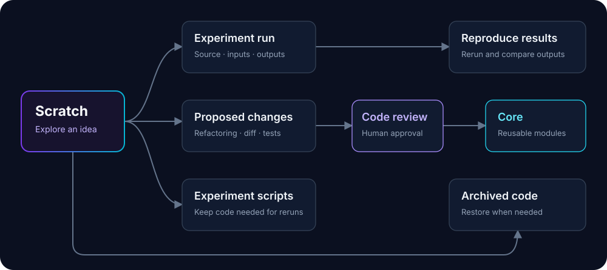

  

  <strong>Explore freely. Preserve experiments. Review shared code.</strong> 
  A Python toolkit for organizing research code and reproducing experiments with coding agents.

  
  
  

Research code grows through preliminary analyses, new methods, additional datasets and models, and
ablations. As agents add each iteration, shared code and experiment-specific code become entangled,
making the project harder to understand, reproduce, and extend.

Sift separates reusable code from exploratory work. Try ideas in scratch, keep experiment scripts
that you need to rerun, and move reusable functions into core after testing and code review. Save
the code, inputs, environment information, and outputs for each experiment run so earlier results
can be checked after the project changes. Archive unused code when you no longer need it.

### Organize research code

| Place | What belongs there | What it can depend on |
|---|---|---|
| **Core** | Tested, reusable modules: data loading, model components, training, evaluation | Other core modules, subject to the project's import rules |
| **Experiments** | Experiment scripts and configurations you want to keep and rerun | Core and the experiment's own modules |
| **Scratch** | Exploratory scripts, notebooks, debugging, and one-off analyses | Core and the exploration's own modules |

A script can be worth keeping because it reproduces a reported result, even if no other experiment
will reuse it. Core is for code shared across experiments. Moving code into core means committing to
maintaining it; it does not establish that the underlying method works.

### Install

~~~bash
uv tool install git+https://github.com/elijah0430/Sift.git
# Or: pip install git+https://github.com/elijah0430/Sift.git
~~~

Initialize an existing project without moving its source:

~~~bash
cd my-research-project
sift init
sift status
~~~

Map existing directories in `research.toml`. You can keep your existing training framework and scripts.

The researcher normally uses three commands:

~~~bash
sift status                       # What is active and what needs attention?
sift review                       # Review a proposed change to maintained code
sift reproduce EXPERIMENT_OR_RUN  # Rerun saved code and compare its outputs
~~~

The agent uses `explore`, `run`, `preserve`, `propose`, and `archive` while carrying out the
research. Internal review hashes and transaction steps remain available through the lower-level
commands, but they are not part of the normal researcher workflow.

### Try a complete, runnable example

The [example research project](examples/minimal) uses only the Python standard library.

~~~bash
git clone https://github.com/elijah0430/Sift.git
cd Sift/examples/minimal

sift check
sift run "python scratch/baseline/experiment.py" --artifact results/metrics.json --input dataset=data/original.json
sift run "python scratch/expanded/experiment.py" --artifact results/metrics.json --input dataset=data/shifted.json --seed 7
~~~

The second experiment adds a dataset, model, and metric while core stays unchanged. Use the baseline
run's printed ID to keep the version of the script that produced its results, then archive its scratch
directory:

~~~bash
sift preserve baseline --name baseline-study --run RUN_ID
sift archive scratch/baseline
sift reproduce baseline-study
~~~

`sift reproduce` accepts either a preserved experiment name or a run ID. It uses saved code and
inputs even after core changes.
It compares the new outputs with the original results and saves the comparison separately.

### Move reusable code into core through code review

~~~bash
sift propose --title "Share the calibrated scorer" --rationale "Two experiments use this scoring function"
~~~

Sift prints a separate review workspace. When Git is installed, that workspace is a local repository
whose initial commit is the proposal baseline. The agent edits it while the original maintained code
remains unchanged. Editor Source Control views then show the proposed files as ordinary uncommitted
changes.

~~~bash
sift propose PROPOSAL_ID --ready
~~~

This runs the import rules and configured tests, saves an exact review version, and tells the
researcher that `sift review` is ready.

A researcher reviews the changes in one terminal flow:

~~~bash
sift review
~~~

If an editor command is configured, Sift opens the review workspace in the researcher’s normal code
review interface. For example:

~~~toml
[review]
command = "code --wait"
~~~

The editor provides the changed-file list, side-by-side diffs, project navigation, and direct
editing. After it closes, Sift offers:

~~~text
[o] open code review  [d] terminal diff  [c] checks
[f] request changes   [a] approve and apply  [l] later
~~~

The editor command can also come from `VISUAL`, `EDITOR`, or `--editor`. Use `--terminal` to stay in
the pager. If the researcher edits the candidate, Sift can rerun the same checks and display the new
diff before enabling approval. Requesting changes saves concrete feedback with the proposal; the
agent reads it with `sift propose PROPOSAL_ID --feedback`, revises the candidate, and marks it ready
again.

**Passing tests does not grant approval.** Approval applies only to the reviewed version. Changes to
the proposed code, diff, or test report require running `seal` again and obtaining new approval.
Changes to the original project's core, tests, configuration, or affected scripts also require a new
review. If applying an approved change is interrupted, Sift can resume after checking for conflicting edits.
If another session updates and approves the proposal, an open review still cannot apply that newer
version: reopen `sift review` to inspect it first.

### Track experiment runs and reproduce results

An **experiment run** is one execution of a script or command. Sift saves a snapshot of the source
code and runs a separate copy. It logs the command, related previous run, description of the change,
inputs and their hashes, random seeds, runtime information, dependency files, logs, and specified
output files (**artifacts**). It removes previous copies of those outputs before execution so stale
results cannot be mistaken for new ones.

~~~bash
sift run "python scratch/my-method/train.py" --artifact results/metrics.json --input dataset=data/train.json --seed 7 --meta model=small
~~~

Seeds are recorded and exposed as `SIFT_SEEDS`; your experiment remains responsible for setting its
random generators. Captured inputs are available through `SIFT_INPUT_NAME`. An unresolved identifier
is logged, but is not sufficient to verify that the results can be reproduced.

For stochastic outputs, supply `--verify "python verify.py"`. That program encodes your numerical
tolerances or statistical criteria and can read original outputs from `SIFT_REFERENCE` when rerunning
the experiment. Without this comparison program, Sift checks whether the specified output files have
identical hashes.

Use `--environment uv` to reconstruct a project from its frozen `uv.lock`. The default preserves the
selected project environment. Sift does not promise bitwise reproducibility across different GPU stacks.

### Cache intermediate results

~~~bash
sift cache key --code encoder-v3 --input dataset-sha256 --config batch=32 --seed 7 --environment torch-v2
sift cache key --code encoder-v3 --input dataset-sha256 --seed 7 --fresh
~~~

Use a cache key to reuse an expensive computation, such as preprocessing or feature extraction.
Include the code version, input data, configuration, random seed, and environment that affect its
output. `--fresh` adds a unique identifier for a new run; it does not change the random seed or
guarantee statistical independence. Sift stores files by content hash and rejects different outputs
under the same key. It cannot automatically identify every dependency of arbitrary Python code.

Remove an unused key with `sift cache drop KEY`. The cached file remains until cleanup confirms that
no runs, cache entries, or pins still reference it.

### Archive unused code and clean up old files

~~~bash
sift archive scratch/old-idea
sift archive --restore ARCHIVE_ID
sift pin RUN_ID
sift gc plan
~~~

`sift archive` checks whether maintained code or active runs depend on the directory, verifies an
archive copy, then removes the directory from the working project. `restore` checks the archive
before copying it back. Cleanup considers file age and references from saved experiments, related
runs, rerun comparisons, pending code changes, cache entries, and pinned items.

A researcher reviews the files listed by `sift gc plan`, then applies that plan with
`sift gc apply PLAN_ID`. New pins or references invalidate the plan. **Files permanently deleted by
`sift gc apply` cannot be restored by Sift.**

### Agent skill and harness

The skill is bundled in the installed package:

~~~bash
sift skill install
# Another agent's skill root:
sift skill install --target /path/to/agent/skills
~~~

The [skill](skills/sift/SKILL.md) guides the agent through exploratory coding, saving experiment
scripts, refactoring shared code, reporting tests and results, and archiving unused code. The agent
prepares core changes and hands them to the researcher through `sift review`. A human must approve
core changes and permanent cleanup.

The [harness](harness/README.md) checks which commands an agent may run and which files it may edit,
and can launch an agent in a separate working copy:

~~~bash
sift harness policy
sift harness guard -- sift propose --title "Shared evaluation function"
sift harness launch -- your-coding-agent
~~~

The default launcher gives the agent a separate working copy and detects changes to the original core.
It is **not an OS sandbox**. On Linux, `--sandbox bubblewrap` supplies a read-only filesystem with a
writable working copy. Otherwise, connect the supplied policy to your host's filesystem/tool permissions.
Interactive input alone cannot authenticate a human against an unrestricted same-user agent.

### Integrations without a new research framework

| Integration | How it fits |
|---|---|
| **uv** | Frozen project environments and per-script dependency metadata |
| **Import Linter / Tach** | `sift check --engine import-linter` or `--engine tach` runs native contracts alongside Sift's rules |
| **marimo** | `sift explore NAME --notebook` creates an optional reactive scratch notebook |
| **Artifact storage** | `sift artifact put/get --store PATH` works with local or mounted storage |
| **Existing remote stores** | `CommandArtifactStore` adapts explicit upload/download argv and verifies downloaded content |
| **Schedulers** | `sift run ... --launcher "srun --partition=gpu"` delegates execution on a shared filesystem |
| **Python** | [`sift.api`](src/sift/api.py) provides the same operations and storage adapters for Python code |

The scheduler launcher is synchronous and expects the source path and environment to be accessible
on the execution node. It does not upload a project or provision a cluster. Plain Python callables
provide replaceable experimental components; adopting Hamilton or another graph framework is optional.

### Commands and documentation

| Task | Commands |
|---|---|
| Researcher | `status` · `review` · `reproduce` |
| Agent research lifecycle | `explore` · `run` · `preserve` · `propose` · `archive` |
| Inspect and validate | `inspect` · `check` · `doctor` · `export` |
| Store results | `artifact` · `cache` · `pin` · `gc` |
| Low-level promotion and recovery | `promote` · `replay` · `retire` |
| Connect an agent | `skill` · `harness` |

Use `sift --json COMMAND` for structured output. `sift review` is interactive and keeps the code
review visible in the terminal.
[Design and configuration](docs/design.md) · [Test coverage](docs/acceptance.md) ·
[Runnable example](examples/minimal/README.md) · [Agent workflow](skills/sift/references/workflows.md)

### Develop

~~~bash
uv sync --extra dev
uv run pytest
uv run ruff check .
uv build
~~~

Sift targets Python 3.11+ on Windows and Linux. Core runtime has no mandatory third-party dependencies.
Optional integrations are activated when used. [MIT licensed](LICENSE).

