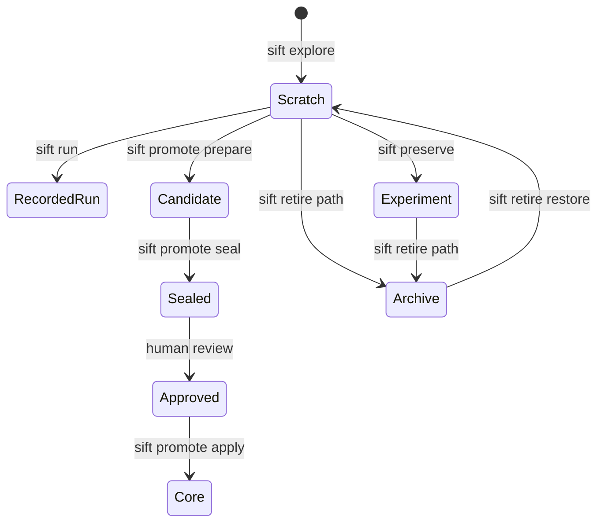
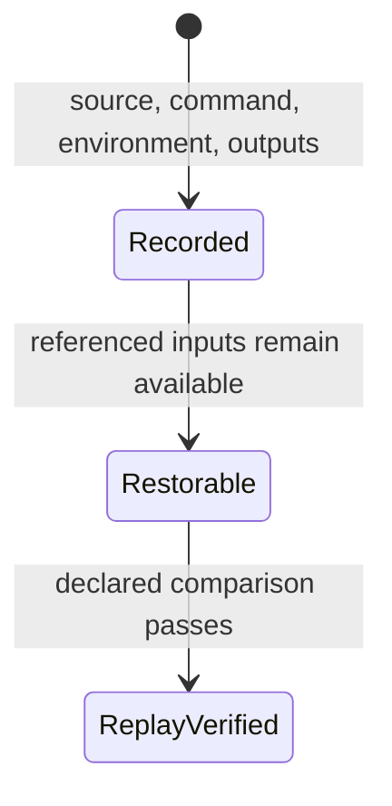

# Design

Sift models research code and research evidence as separate lifecycles. A preserved experiment may use
one-off code. A clean core component may still implement a hypothesis whose scientific value remains
uncertain. Neither lifecycle silently stands in for the other.

## Code states

Promotion is intentionally asymmetric. Agents may prepare and seal candidates. Human-controlled
commands approve and apply the exact candidate digest. Applying also checks every affected base file,
so approval cannot be carried across an intervening edit.

## Evidence states

Sift currently implements exact artifact comparison. Projects with stochastic outputs should register
stable evaluation artifacts or run a domain-specific comparison with justified tolerances.

## Trust boundary

The CLI enforces proposal integrity and interactive approval. Filesystem write restriction belongs to
the host because a process with unrestricted shell access can bypass a command wrapper. The included
harness policy declares the required scopes in a machine-readable form.

